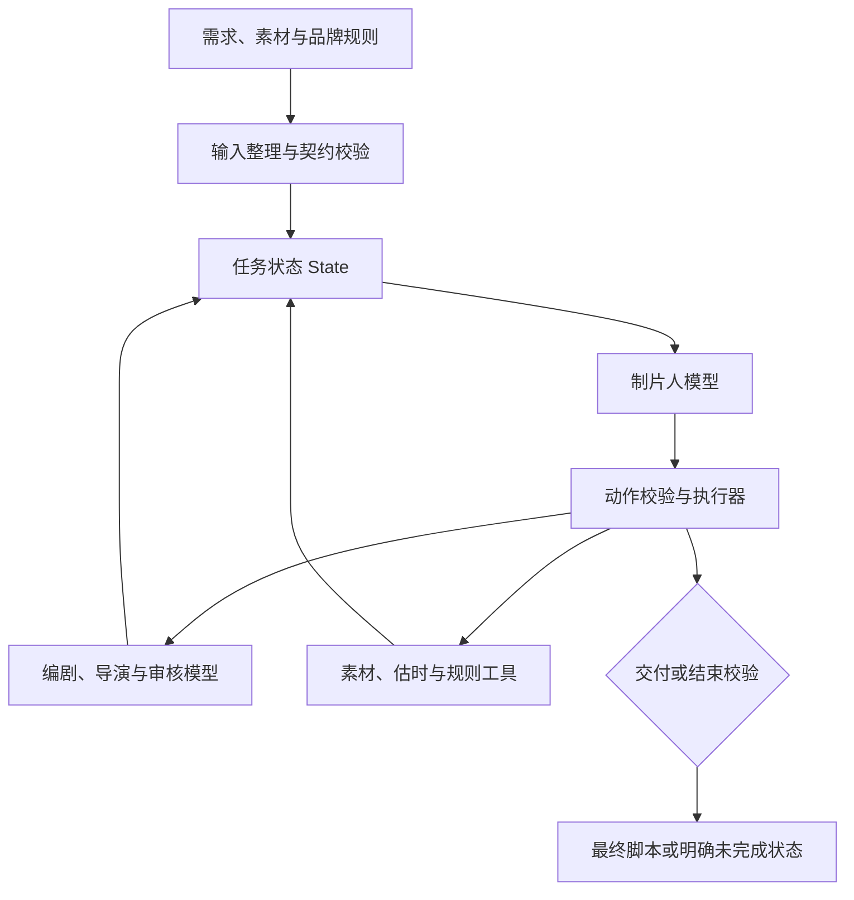
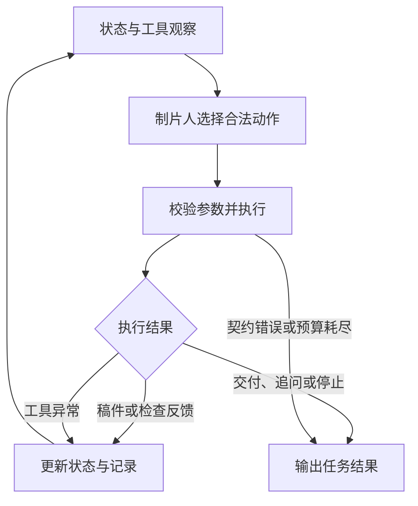

# 技术方案

## 1. 设计目标与总体架构

本项目将制作需求、产品素材和品牌规则转化为有事实依据、满足时长上限的中文分镜脚本。整体设计借鉴 AutoGen 的多 Agent 协作思路，以独立角色、结构化消息、工具调用和反馈循环组织任务；工程实现采用**制片人统一决策、专业角色分工创作与审核、工具提供检查反馈、有界状态机控制执行和交付**。

项目采用 Python 原生实现，提供 CLI。角色通过结构化对象协作，一次任务的素材、方案、稿件、版本、检查结果与调用计数统一保存在 `State` 中。模型读取状态并选择动作，执行器调用角色或工具，校验结果后更新状态，进入下一轮。

| 层次 | 主要实现 | 职责 |
| --- | --- | --- |
| 输入与交付 | [main.py](../src/main.py)、[intake.py](../src/intake.py) | 读取文本或 JSON，整理需求，输出 Markdown、JSON 与 Trace |
| 数据契约 | [schema.py](../src/schema.py)、[contracts.py](../src/contracts.py) | 定义共享对象，校验返回结构、字段修改范围及业务约束 |
| 编排与状态 | [studio.py](../src/studio.py)、[remote.py](../src/remote.py) | 构造候选动作、执行模型决策、维护状态、控制预算和交付 |
| 创作与审核 | [llm_studio.py](../src/llm_studio.py)、[semantic_grounding.py](../src/semantic_grounding.py) | 创意方案、脚本、分镜、事实审核、制作审核与创作评审 |
| 业务工具与传输 | [tools.py](../src/tools.py)、[remote.py](../src/remote.py) | 检索、估时、品牌检查和统一 HTTP 模型调用 |

`StudioModels` 定义角色接口；`RemoteStudio` 提供模型实现，`MockModels` 提供离线实现。CLI 通过 `--model` 选择适配器，业务工具和编排流程保持一致。模型角色共用一个配置端点与模型，采用独立任务提示，按状态依次调用。

AutoGen 思路与本项目实现的对应关系如下：

| AutoGen 协作概念 | 本项目对应实现 |
| --- | --- |
| 多个专业 Agent | 制片人、编剧、导演、事实审核、制作审核和创作评审分别拥有独立任务提示与返回契约 |
| Agent 间消息传递 | `Brief`、`CreativePlan`、`Draft`、`Scene`、检查报告和上一轮观察作为结构化消息写入 `State` |
| Tool Calling | 素材检索、时长估算和品牌规则检查由执行器调用本地工具，并把结果反馈给制片人 |
| Conversation / Feedback Loop | 制片人读取状态与工具观察，选择下一动作，执行结果再进入下一轮决策 |
| Termination Condition | `DELIVER`、`ASK`、`STOP` 及步骤、工具、修订预算共同定义结束条件 |

原生状态机将 AutoGen 式角色协作映射为可执行的业务动作，并显式控制候选动作、字段修改范围、版本失效和交付门禁。各角色保持独立接口，通过结构化状态完成反馈式协作。

## 2. 架构选型与技术取舍

| 决策 | 选择及原因 | 对工程实现的影响 |
| --- | --- | --- |
| 编排框架 | 借鉴 AutoGen 多 Agent 协作思路，使用原生 Python 状态机落地角色通信、动作选择、工具反馈和版本校验 | 标准库即可运行，方便逐步调试；新增动作需同步维护候选集合、执行分支与测试 |
| 多角色协作 | 采用制片人统筹的集中编排。相较自由群聊，职责接口更容易控制调用顺序、停止条件和稿件版本 | 编剧、导演和审核共享统一需求，减少重复解释；每项产出都有独立契约 |
| 决策范围 | 预设阶段骨架内，由模型从合法动作中选择 | 保留补检、选题、修订与停止的决策空间，同时控制越过检查或跨主体引用 |
| 模型接入 | 统一 Chat Completions 兼容接口，各角色共享配置 | 端点与模型可替换；服务返回内容须符合任务 JSON 契约 |
| 需求整理 | 字段提取、枚举映射、来源记录与确定性校验 | 输入问题可定位到原文；当前 CLI 使用本地解析与意图规则，减少前置模型调用 |
| 素材检索 | 主体及可选 ID 过滤，再做规范化关键词匹配 | 适合当前小规模资料，命中依据易核对；空结果由模型选择改写查询或请求补充 |
| 质量审核 | 事实、制作和创作质量分别检查 | 硬性错误与创作建议有独立处理路径，反馈可定位到字段；相应增加模型调用 |
| 改稿方式 | 定向修改，修改后重新验证 | 保留已确认事实和转化入口；当前返修主要在已有镜头结构内进行 |
| 运行方式 | 单任务同步执行，设置步骤、工具和修订预算 | 便于 CLI 复现及故障定位；异步调度与视频渲染作为后续集成方向 |

多角色分工围绕具体产物展开：编剧决定内容和情节，导演规划拍摄与镜头时间，审核判断依据、可拍性和创作质量，制片人负责将这些产出组织成可结束的任务。

## 3. 输入整理与数据契约

### 3.1 输入处理

文本入口包含 `【制作需求】`、`【素材】`、`【品牌规则】` 三个区块；JSON 可提供相应文本和 `confirmed` 确认字段，也支持直接提交标准字段。

输入整理依次执行区块拆分、字段及候选值提取、来源记录、枚举与单位标准化、缺失／冲突检查和业务校验。字段来源保留文件、区块、行号及原文。`confirmed` 用于提供已确认的值，原始候选记录仍保留在整理结果中。

当前使用单次本地解析与确定性检查。`IntentExtractor` 保留意图提取接口，CLI 使用本地规则实现；该阶段没有额外模型调用。将前置解析集中在一个模块，便于核验来源和处理冲突，也减少各角色对同一需求产生不同解释。

商业目标、内容形式和风格分别建模。例如，“促进购买”决定转化方向，“剧情”决定叙事形式，“轻松幽默”决定表达偏好。开场、转折和结局由创作角色补充；用户明确提供的创意默认按 `locked` 保留，标为 `reference` 后允许定向修改。

### 3.2 核心对象

| 对象 | 关键字段 | 下游用途 |
| --- | --- | --- |
| `Brief` | 主题、受众、平台、目标时长、风格；商业目标、内容形式、主体、转化动作与入口；创意及锁定策略 | 所有角色的统一需求输入 |
| `Material` | `id`、`subject`、`fact`、`visual`、`operation`、`source`，以及别名和标签 | 区分事实、可见画面与操作依据 |
| `CreativePlan` | 人物目标、障碍、商品作用、开场、转折、结局、转化理由、素材 ID、创作假设与字段来源 | 编剧提案、制片人选择、正文创作 |
| `Draft / Beat` | 标题；逐镜编号、用途、动作、旁白、字幕、素材 ID | 文案与剧情的编辑对象 |
| `Scene` | 对应 Beat、计划秒数、动作最低秒数、景别、声音、转场、连续性 | 导演输出及估时输入 |
| `Decision` | `action`、`reason`、`args`、`decision_source` | 动作执行和决策记录 |
| `State` | 当前方案、稿件、分镜、版本、检查报告、上轮结果与计数 | 决策上下文和交付依据 |

品牌规则由工具实例持有，包含 `banned_terms` 与 `required_terms`，并进入模型创作上下文。时长、禁用词、必说项、引用及锁定内容由代码校验；风格、情节、节奏和情绪表达由创作角色处理。

## 4. 角色定义与协作接口

下表描述 `llm` 模式。创作、语义审核与动作选择调用模型；检索、计算和明确的规则校验使用本地模块。

| 角色或模块 | 输入 | 任务与输出 | 执行边界 |
| --- | --- | --- | --- |
| 制片人 | Brief、合法动作、素材、方案、稿件、工具与审核结果、上轮观察及计数 | 返回动作、简要依据、查询词或方案 ID；决定补检、修订、追问、停止或交付 | 每轮调用模型；代码校验动作与参数，交付再次检查当前版本 |
| 编剧 | Brief、素材、品牌规则、已选方案；返修时含定位问题 | `plan` 提出 1—2 个方向；`write` 生成标题与完整稿件；`rewrite / shorten` 定向改稿 | 产品主张附素材依据，保留事实、锁定内容和转化入口 |
| 导演 | 稿件、目标时长、已有分镜、压缩标志与反馈 | `direct` 输出逐镜构图、声音、转场、连续性、计划秒数与动作下限 | 沿用镜头编号、顺序和文案；压缩同一动作时保留原下限 |
| 道具／素材准备 | 主体、模型选择的查询词、可选素材 ID | 整理检索参数，调用 `search_material`，返回事实、操作、画面及来源 | 本地模块实现；固定需求主体，查询词由制片人模型决定 |
| 事实审核 | 标题、每镜动作／旁白／字幕与素材 | `grounding` 逐字段分类，返回判断、依据和原文引用 | 独立模型调用后，代码核对字段覆盖、素材 ID 及引文 |
| 制作审核 | 稿件、分镜、素材和本地核验结果 | `review` 检查引用、转化入口、镜头对应、可拍性和连续性 | 合并确定性检查与模型意见；审核本身不修改稿件 |
| 创作质量评审 | 需求、方案、稿件、分镜与反馈 | `critique` 检查目标、悬念、动机、因果、商品融入、节奏与结尾兑现 | 当前版本硬性检查和制作审核通过后运行；问题定位到原句和字段 |
| 质量工具 | 分镜、目标时长、品牌规则与素材 | 输出逐镜估时、总时长、规则问题和错误类型 | 本地计算及检查，结果进入下一轮决策上下文 |
| 最终输出模块 | 当前版本稿件、分镜、检查与素材 | 组装 Markdown／JSON，附时间、引用、风险和状态 | 仅在 `COMPLETED` 时输出最终 `script` |

同一角色按任务分别调用。例如，编剧提案、正文创作、时长压缩和定向返修分别对应 `plan`、`write`、`shorten`、`rewrite`。任务提示和响应结构集中在 `llm_studio.py`，便于分别调优。

两类范围明确的局部修复由制片人选择、代码执行：`REPAIR_TITLE` 删除已定位的标题禁用词；`ADD_DISCLOSURE` 将有素材依据的必说项加入说明镜头。它们使用删除操作或已有原文，执行后同样重新检查。

## 5. 完整调用流程

正常任务采用以下阶段骨架。每个动作执行前，制片人读取当前状态并选择动作；阶段规则同时提供适用的停止路径。

| 阶段 | 动作与调用 | 状态变化及校验 |
| --- | --- | --- |
| 1. 接收需求 | CLI 整理 Brief、素材和规则 | 缺失或冲突进入补充／确认流程，有效输入建立 State |
| 2. 准备素材 | `FIND_MATERIAL` → 道具参数整理 → `search_material` | 校验主体与 ID，保存结果，空结果进入补检或追问 |
| 3. 创意提案 | `PLAN` → 编剧 `plan` | 保存 1—2 个方案，校验素材、字段来源及锁定内容 |
| 4. 选择方向 | `SELECT_CONCEPT` → 制片人返回 `plan_id` | 保存选定方案与选择理由 |
| 5. 生成文案 | `WRITE` → 编剧 `write` | 生成 Draft，校验逐镜结构与锁定内容 |
| 6. 编排分镜 | `DIRECT` → 导演 `direct` | 建立 Scene，更新版本，清除旧检查 |
| 7. 工具与事实检查 | `CHECK` → `estimate_duration` → `check_brand` → `grounding` | 保存当前版本时长、品牌和来源报告，反馈给制片人 |
| 8. 制作审核 | `REVIEW` → 本地核验与模型 `review` | 保存可拍性、入口、引用和连续性问题 |
| 9. 创作评审 | `CRITIQUE` → 模型 `critique` | 保存原句、修改目标及应保留内容，必要时返修 |
| 10. 结束任务 | `DELIVER`、`ASK` 或 `STOP` | 输出最终脚本，或明确的补充事项／失败状态 |

一次 `CHECK` 包含两次业务工具调用及一次事实审核模型调用。工具与模型次数分开记录：“10 次工具上限”统计素材检索、时长估算和品牌检查；模型调用受整体步骤上限和每个动作的固定调用结构约束。

## 6. 动态决策与反馈闭环

### 6.1 模型如何选择动作

`RemoteProducer.producer` 根据状态构造 `allowed_actions` 和参数范围，向模型提供上一轮事件、工具返回、当前稿件和检查结果。模型返回 `action` 与一句话 `reason`；检索时另返回 `query`，选题时另返回 `plan_id`。

候选集合沿用本地阶段规则生成，通常包含当前阶段动作与停止动作；空检索、时长调整等状态提供额外选项。模型决定选择哪一项，以及查询词和方案 ID；执行器校验后调用。缺少关键字段等状态只有受约束的处理出口。

### 6.2 观察如何改变后续动作

| 观察 | 可选择动作 | 约束与后续处理 |
| --- | --- | --- |
| 关键字段缺失 | `ASK` | 返回缺失字段，状态为 `NEEDS_INPUT` |
| 第一次检索为空 | `FIND_MATERIAL` 或 `ASK` | 保持主体并改写查询，可用空词放宽；无素材则 `MATERIAL_REQUIRED` |
| 工具执行异常 | 有限重试或 `STOP` | 异常进入下一轮观察，重试仍失败则 `TOOL_FAILED` |
| 估时超标 | 候选范围内的 `REVISE_COPY`、`COMPACT_SCENES` 或 `STOP` | 修改指定文案或调整镜头停留，再次估时 |
| 有依据的必说项缺失 | `ADD_DISCLOSURE` 或 `STOP` | 增加原文说明镜头，重新排镜与检查 |
| 标题有可移除禁用词 | `REPAIR_TITLE` 或 `STOP` | 只删除定位词项，更新版本并重查 |
| 来源审核发现无依据表述 | `REPAIR_UNVERIFIED` 或 `STOP` | 重写可修改字段；涉及锁定内容或无法处理时进入复核 |
| 创作评审发现可修改问题 | `REWRITE_CREATIVE` 或 `STOP` | 按原句及目标返修，保留其他字段和事实，重新完成检查 |
| 当前版本全部检查通过 | `DELIVER` 或 `STOP` | 模型提出交付，执行器再次核验交付条件 |

动作可用性受问题类型、锁定字段及预算约束。一般制作审核失败当前返回 `QUALITY_FAILED`；具有专门修复接口的事实、标题、必说项和创作问题进入对应修订路径。时长修订后仍超标时，当前策略返回无法满足，控制持续压缩对内容的影响。

### 6.3 已保存的执行路径

以下为离线实际运行记录，用于复核分支与状态变化。模型接入与外部服务验证状态见 [效果评估](03-evaluation.md)。

| 用例 | 实际动作变化 | 结果与记录 |
| --- | --- | --- |
| 正常商品带货 | 检索 → 提案 → 选题 → 文案 → 分镜 → 检查 → 制作审核 → 创作评审 → 交付 | 23 秒；[Trace](../examples/runs/creative_sales.trace.json) |
| 目标时长改为 15 秒 | 首轮 23 秒 → `COMPACT_SCENES` → 再次 `CHECK` 得到 13 秒 → 审核交付 | [Trace](../examples/runs/creative_short.trace.json) |
| 无素材 | 检索为空 → 第二次检索 → `ASK` | `MATERIAL_REQUIRED`；[Trace](../examples/runs/creative_no_material.trace.json) |
| 检索工具持续异常 | 调用失败 → 重试 → `STOP` | `TOOL_FAILED`；[Trace](../examples/runs/creative_tool_failure.trace.json) |

## 7. 事实、制作和创作质量检查

### 7.1 事实依据

素材将 `fact`、`visual` 与 `operation` 分开：功能结论对应事实原文，动作和可见细节对应操作与画面资料。产品相关镜头保留素材 ID，最终脚本附原文与来源。

`semantic_grounding.py` 对标题及逐镜动作、旁白、字幕组织独立模型审核，区分有依据的产品主张、虚构情境、无依据主张和不确定内容。代码随后核验字段覆盖、重复记录、被审文本、素材 ID、来源字段及逐字引文。人物情境允许原创，产品效果、价格、数据和优惠条件须有素材支持。

证明与说明镜头保留对应事实、画面原文，操作镜头保留操作原文；其他字段可采用有依据的改写。离线模式由 `grounding.py` 执行来源匹配。

### 7.2 制作审核

制作审核合并本地原文及转化入口核验，以及模型对可拍性、人物物件一致性和镜头衔接的判断。当前剧情形式还检查用途序列：开场、转折、可选操作、商品证据、人物结局；允许同用途连续多镜，说明镜头单独处理。

该结构保证剧情具有转折、证据和收尾，便于逐镜检查；采用其他叙事顺序时，需要同步调整用途校验与测试。导演负责已有镜头的拍摄参数，文案结构由编剧负责。

### 7.3 创作评审与定向返修

创作评审关注开场期待、人物动机、因果、商品作用、结尾兑现与节奏。问题结构包含 `scene_id`、`field`、`code`、`evidence`、`revision_goal` 和 `preserve`。`evidence` 对应被审字段原文，使修改目标能够被复核。

编剧只修改定位字段；代码校验镜头编号、用途、顺序、素材引用、事实、锁定内容和转化入口，其余内容保持原样。评审在时长、品牌、来源及制作检查通过后运行，将调用预算用于具备交付基础的稿件。返修后重新排镜、检查与审核。

## 8. 时长估算与版本一致性

每镜有效时长取四项的最大值：导演计划时长、动作最低时长、口播估时、非重复字幕阅读估时。总时长为逐镜有效时长之和。

口播默认每秒 4 个阅读单位，字幕每秒 6 个单位，并处理标点、数字和部分符号。字幕与旁白完全相同时，字幕阅读时间不重复计入。工具返回逐镜依据及超出秒数，供制片人判断修改位置。

目标时长是上限。已满足上限的稿件进入后续审核；实际超标才进入时长修订。镜头压缩保留同一动作的原下限，文案压缩保留事实、锁定内容与转化入口。

文案修改清空分镜及旧检查，重新排镜后增加版本；导演调整或局部标题修改也更新版本。修改使旧质量、制作和创作报告失效。交付要求：

- 存在有效稿件、分镜和已选方案。
- 时长、品牌、来源、制作与创作检查均通过。
- 所有适用报告的版本号与当前版本一致。

这样可以避免修订后的内容沿用修改前的通过结果。

## 9. 执行预算、错误处理与模型接口

默认上限为 **20 步、10 次业务工具调用、2 轮共享修订**。时长、创作、事实与规则修复共同消耗修订预算。耗尽时返回 `STEP_LIMIT`、`TOOL_LIMIT` 或 `REVISION_LIMIT`，保留过程记录。

工具可用性异常进入下一轮观察，制片人选择重试或停止；工具返回结构不合法时返回 `TOOL_FAILED`；模型请求、JSON 解析或角色契约失败时返回 `MODEL_FAILED`。每次任务重置上下文与调用统计。

`remote.py` 统一发送 HTTP 请求，使用 `STUDIO_LLM_URL`、`STUDIO_LLM_MODEL` 和 `STUDIO_LLM_KEY` 配置。请求携带任务系统提示与结构化上下文，响应从 `choices[0].message.content` 读取 JSON。采用 HTTPS 或本机回环 HTTP，单次超时 20 秒、响应上限 128 KiB，拒绝重定向。调用失败保持失败状态。

接口协议、角色响应与状态码详见 [接口与输出](07-interface.md)。

## 10. 输出、运行记录与验证入口

成功结果包含标题、分镜动作、旁白或字幕、逐镜起止时间、预计总时长、素材 ID 与原文、拍摄说明、风险和任务状态。只有 `status=COMPLETED` 时，`script` 才作为最终脚本交付。其他状态输出补充事项或失败原因，过程稿保存在 Trace 中。

Trace 逐步记录动作、参数、工具结果、后续动作、简短依据与版本。模型调用另记录角色、模型、传输方式、耗时及请求／响应摘要。运行审计记录输入、素材、规则摘要和预算计数，便于替换资料或调整时长后比较动作。Trace 文件采用原子写入。

| 验证内容 | 入口 |
| --- | --- |
| 环境与运行命令 | [README](../README.md) |
| 核心验收场景及产物 | [核心用例](../examples/REVIEW.md) |
| 可执行自动测试 | [tests](../tests) |
| 全角色接口与编排协议记录 | [protocol-results.json](../examples/protocol-results.json) |
| 外部模型验收入口 | [run_live_acceptance.py](../examples/run_live_acceptance.py) |
| 测试预期、实际结果、失败与限制 | [效果评估](03-evaluation.md) |

当前方案以可编辑脚本和执行记录为交付单位。后续接入配音、图像或视频生成时，可消费分镜 JSON、素材引用及时间信息，并将实际生成结果反馈给新的检查环节。
